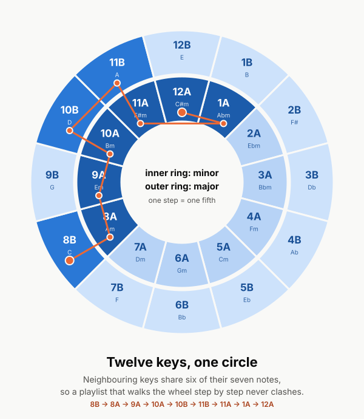

# playlist-analyzer

**Will this playlist flow?** playlist-analyzer reads an exported playlist (title, artist, musical key, tempo, energy) and tells you:

- which **keys** and **tempos** the playlist lives in,
- how its **energy** rises and falls from track to track,
- which back-to-back tracks **mix well** and which **clash**, using the Camelot wheel,
- and an **order that would flow better**, with before/after scores.

It is a Python 3 command-line tool with **zero dependencies** (standard library only), plus a static **browser demo** that runs the same analysis offline. It reports in three formats from one analysis: plain text, JSON and a self-contained HTML page.



## Why it matters

When one song blends into the next, for a few seconds you hear both at once. If their keys share most of their notes and their tempos are close, the blend sounds like one piece of music. If not, you get a sour clash or a lurching gear change. DJs avoid this with *harmonic mixing* and *beatmatching*. The same ideas make any playlist better: a workout mix, a dinner party, a road trip. Most people never see the keys and tempos of their songs, so they can't tell why a playlist feels bumpy. This tool shows them, and explains the theory in plain English as it goes.

## Quick start

You only need Python 3 (developed and tested on Python 3.12). There is nothing to install.

```bash
# full text report (the "analyze" command is the default)
python3 -m playlist_analyzer examples/sunset-drive.csv

# the problem playlist: clashes, tempo jumps, and a suggested fix
python3 -m playlist_analyzer analyze examples/mixed-bag.json

# machine-readable JSON
python3 -m playlist_analyzer analyze examples/mixed-bag.json --report json > report.json

# self-contained HTML report (inline CSS + SVG charts, no external assets)
python3 -m playlist_analyzer analyze examples/mixed-bag.json --report html -o mixed-bag-report.html

# just the suggested order
python3 -m playlist_analyzer reorder examples/mixed-bag.json

# look up a key, or check a single move between two keys
python3 -m playlist_analyzer key "F# minor"
python3 -m playlist_analyzer key 8A 10A

# read from stdin in the quick-paste format
printf 'Mara Vey - Coastline Static | Am | 100 | 4\nJuniper Atlas - Paper Lanterns | 9A | 102 | 4\n' \
  | python3 -m playlist_analyzer analyze - --format text
```

Options for `analyze` and `reorder`:

| Option | Meaning |
|---|---|
| `-f, --format auto\|csv\|json\|text` | Input format. `auto` (default) guesses from the file extension, then the content. |
| `-r, --report text\|json\|html` | Report type for `analyze` (default `text`). |
| `-o, --output FILE` | Write the report to a file instead of stdout. |
| `--name NAME` | Playlist name shown in reports (default: from the file name). |
| `--lenient` | Skip invalid rows instead of failing. Every skipped row is still listed as a warning in the report. |
| `--no-reorder` | Skip the suggested-order step. |
| `--json` | (`reorder` only) print JSON. |

Exit codes: `0` success, `1` file not found / no command, `2` invalid input (with every bad row listed on stderr).

### Browser demo

Open [`docs/index.html`](docs/index.html) directly in a browser (a `file://` open works) or serve `docs/` with GitHub Pages. Paste CSV or JSON, open a file, or click **Sunset Drive** / **Mixed Bag** to load an example in one click. The demo is vanilla JavaScript in a single `app.js`: no build step, no external assets, no network requests. It is a line-for-line port of the Python package, and the test suite runs it under Node to check that it produces **byte-identical** analysis and report markup.

## Input formats

**CSV** with a header row. Required columns: `title, artist, key, bpm, energy`. Optional: `duration` (`3:45`, seconds, or a `duration_ms` column) and `genre`. Real exports are messy, so it also handles:

- extra columns (ignored), any column order, and common header aliases (`Track Name`, `Initial Key`, `Tempo`, `Camelot`, `Energy Level`, `Length`…);
- quoted fields with commas and `""` escapes, a UTF-8 BOM, CRLF line endings, blank lines;
- `,` `;` or tab delimiters, and decimal commas (`98,5`) with `;`-separated files;
- keys written as `8A`, `08a`, `A minor`, `Am`, `a min`, `C major`, `C`, `Cmaj`, `F#m`, `F♯ minor`, `E flat minor`, `Bbm`, `1A`…;
- energy on a 0-10, 0-1 or 0-100 scale (detected per playlist and rescaled to 0-10, with a note in the report).

**JSON**: a list of track objects with the same fields, or `{"name": "...", "tracks": [...]}`. Artist lists (`"artists": ["A", "B"]`) are joined.

**Plain text**, for quick pasting, one track per line:

```
# lines starting with # are comments
Juniper Atlas - Paper Lanterns | 9A | 102 | 4
Halcyon Freight - Mile Marker 9 | E minor | 104 | 5
```

**Errors are specific and never silent.** Bad rows are reported with their row number and every problem in them:

```
$ printf 'title,artist,key,bpm,energy\nA,B,8A,120,5\nC,D,Q,fast,\n' | python3 -m playlist_analyzer analyze - -f csv
error: 1 invalid row(s) in csv input
  - row 3: unrecognised key 'Q' (expected e.g. '8A', 'A minor', 'Am', 'C'); bpm 'fast' is not a number; energy is missing
```

## Example output

`python3 -m playlist_analyzer examples/mixed-bag.json` (excerpt):

```
PLAYLIST ANALYSIS: Mixed Bag
============================
14 tracks | from json
Flow score: 25/100

TEMPO (BPM)
-----------
min 76  max 140  mean 114.86  median 123
       <90  ████████████          3
    90-100                        0
   100-110  ████                  1
   110-120  ████████              2
   120-130  ████████████████████  5
      130+  ████████████          3

TRANSITIONS
-----------
2 compatible, 2 energy boost, 0 energy drop, 9 clash  |  tempo: 1 smooth, 2 tricky, 10 hard
   1->2   8A -> 10A  Energy boost      +6 BPM
         Velvet Arcade - Static Bloom  ->  The Cardboard Kings - Thunder in …
   2->3  10A -> 11A  Compatible       -42 BPM  [HARD JUMP]
         The Cardboard Kings - Thunder in …  ->  Nina Okafor-Lind - Lullaby for Ro…
   3->4  11A -> 8B   Clash            +38 BPM  [HARD JUMP]
   ...

SUGGESTED ORDER
---------------
Flow score 25 -> 70 (+45); energy shape becomes peak-and-valley.
   1. (was  5)   3A     76 BPM  E3    Moss & Marrow - Rain on Tin
   2. (was 11)   7A     84 BPM  E3    Nina Okafor-Lind - Slow Orbit
   3. (was 13)   6A    114 BPM  E5    The Cardboard Kings - Quiet Engine
   4. (was  1)   8A    124 BPM  E6    Velvet Arcade - Static Bloom
   ...
```

The well-built `sunset-drive.csv` scores **100/100**: every transition is compatible, no tempo step is over 4 BPM, and the energy climbs to a peak at track 9 of 14 before easing off. The analyzer leaves its order alone.

The HTML report shows the same analysis as summary tiles, a shaded Camelot wheel with a key table, a tempo histogram, the energy curve (with hover tooltips and peak/low labels), a transition table with labelled badges (never colour alone), and the suggested order with its own energy curve. It follows the system's light or dark mode.

## The theory in one page

The full beginner's guide, with worked examples, is in **[docs/theory.md](docs/theory.md)**. The short version:

- **Circle of fifths.** Arrange the 12 keys so each is a fifth (7 semitones) above the last. Neighbours differ by just one note (C major and G major share 6 of 7), so they blend smoothly. Keys across the circle share almost nothing and clash.
- **Camelot wheel.** The same circle, relabelled: numbers **1-12** for the position, **A** for minor (inner ring), **B** for major (outer ring). 8A is A minor, 8B is C major (its relative major, same notes).
- **Mixing rules implemented here, exactly:**
  - *compatible*: same code (8A→8A), ±1 with the same letter (8A→7A/9A, wrapping 12↔1), or the letter swap (8A→8B);
  - *energy boost*: +2 with the same letter (8A→10A, up a whole tone);
  - *energy drop*: −2 with the same letter (8A→6A);
  - *clash*: everything else, including diagonals like 8A→9B.
- **Tempo.** Beatmatching means nudging one track's speed so the beats line up. A gap of up to **6 BPM** is smooth; **over 6** is tricky; **over 10** is flagged as a hard jump.
- **Energy curve.** Energy (0-10) in playlist order, summarised as *rising*, *falling*, *flat* (range under 2) or *peak-and-valley*, with the peak, the low point and the biggest jumps. Sets, workouts and road trips each want a different shape; random order gives a jagged one.
- **Flow score (0-100).** For each consecutive pair: `0.5 × key + 0.3 × tempo + 0.2 × energy`, where key = 1 compatible / 0.75 boost or drop / 0 clash; tempo = 1 (≤ 6 BPM) / 0.5 (≤ 10) / 0; energy = 1 (change ≤ 2) / 0.5 (≤ 4) / 0. Average × 100, rounded.
- **Suggested order.** A greedy walk around the wheel. From each possible starting track it repeatedly picks the next track that best balances transition quality against a target energy arc (peak about 70% of the way through). It keeps the best walk, never returns an order that scores lower than yours, and never drops or duplicates a track. Details in [theory.md §7](docs/theory.md#7-how-the-flow-score-and-the-reorder-work).

## Honest limitations

- **No streaming services.** It cannot fetch your Spotify or Apple Music library; that needs API keys and accounts, and this project uses neither. Export your playlist (from DJ software such as Rekordbox, Serato or Mixed In Key, an export tool, or a spreadsheet) and give it the file.
- **No audio analysis.** It cannot detect key, tempo or energy from audio files; it never sees audio. Every key, BPM and energy value comes from the export or data you supply. Wrong tags in, wrong analysis out.
- **It cannot play music** or preview a transition.
- Tempo is compared as raw BPM. A half/double-time move (70 → 140) is flagged as a hard jump even though a DJ could make it work.
- Energy scale detection is a per-playlist heuristic (all ≤ 1 → 0-1 scale; any > 10 → 0-100). A 0-10 playlist whose every value happens to be ≤ 1 would be misread as 0-1.
- The reorder is greedy: fast, repeatable and explainable, but not guaranteed optimal. When the tracks are far apart in key and tempo (like `mixed-bag.json`), it improves the flow a lot (25 → 70) but cannot make every transition compatible.
- The rules describe what usually sounds smooth, not what is good. A deliberate clash can be a great creative choice.

## Running the tests

```bash
python3 -m unittest discover -s tests -v
```

The suite covers key parsing (every spelling, all 24 keys, enharmonics, bad input), the Camelot rules, transition classification, tempo flags, histogram buckets, energy-curve shapes, the flow-score formula, the reorder (no drops or duplicates on the samples and on random playlists; the score never gets worse; it improves the clash-heavy sample), all three parsers including malformed-row errors, the text/JSON/HTML report generators (self-contained, escaped, well-formed SVG), the CLI, and the browser demo. If `node` is installed, the demo tests also run `docs/app.js` and check it matches the Python output byte for byte; without Node those checks are skipped and reported as skipped.

## Project layout

```
playlist_analyzer/      Python package (standard library only)
  keys.py               key parsing, Camelot wheel, mixing rules
  parsers.py            CSV / JSON / text import with row-level errors
  analysis.py           key distribution, tempo histogram, energy curve, transitions, flow score
  reorder.py            greedy Camelot walk with energy-arc target
  reports.py            text, JSON and self-contained HTML reports
  style.css             report stylesheet (shared with the demo)
  cli.py, __main__.py   python3 -m playlist_analyzer
docs/
  index.html, app.js    static browser demo (GitHub Pages / file://)
  theory.md             the music theory, for beginners
  index.template.html   source for index.html (see tools/sync_demo.py)
examples/               sunset-drive.csv, mixed-bag.json, quick-paste.txt (all fictional)
tests/                  unittest suite
tools/sync_demo.py      re-embeds style.css and the examples into docs/ after edits
assets/                 music-chapter-figure.svg
```

The sample playlists are fictional: invented titles and artists, not anyone's real tracklist.
